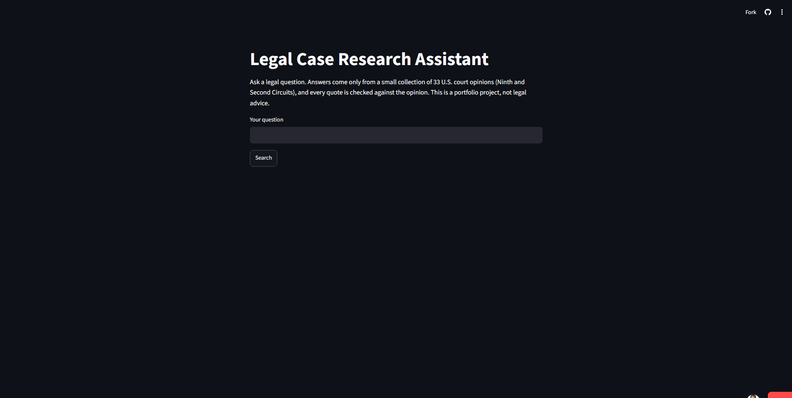

# Legal Case Research Assistant

Ask a legal question and get an answer built only from real U.S. court opinions, with the court, the citation, a link, and a word-for-word quote. If the collection has nothing relevant, it says so instead of guessing.

<!-- Uncomment after adding the files to docs/ (see capture instructions):

-->

**Live demo:** https://legal-case-research-assistant-ccfjbazcmevwz5vrzuwppa.streamlit.app/ (no login needed)

It runs on Groq's free tier, so it limits each visitor to 5 questions every 10 minutes and 40 per day across everyone. A free app that has been idle can also take a while to wake up on the first visit.

> ### Results at a glance
> - **15 evaluation questions**, with expected answers committed to git *before* the first run
> - **4 of 4** out-of-scope questions correctly refused
> - **13 of 15** on the answer-checking model's own regression set. The 2 failures are left in on purpose
> - **11 answerable questions on Groq:** 4 clean hits, 4 hits that are flaky between runs, 2 right case but part of the rule missing, 1 never answered safely
> - **Limit to know:** 33 opinions, two circuits, and I wrote the questions myself. These are small samples, not benchmarks

## The problem

Legal research tools that make up citations are dangerous, because a confident wrong answer looks the same as a right one. This project is built around the opposite rule: show a claim only if its quote really exists in the opinion, and refuse when nothing fits.

## Key features

- **Verified quotes.** Every claim comes with a sentence copied from the opinion itself, not retyped by the model.
- **Refuses instead of guessing.** A relevance gate stops the question before any model is called.
- **Unpublished-opinion warnings.** Unpublished opinions and Second Circuit summary orders are flagged as not binding precedent.
- **Visible failures.** When a claim is dropped, the reason is printed (judge disagreed, quote not found, quote is only a string of citations).
- **Retry on broken output.** If the writer returns malformed JSON, it retries once.
- **Runs offline.** The same pipeline works on a local 3B model through Ollama.
- **Request limits.** Per-visitor and daily caps, so a public demo can't use up a free API quota.
- **Reproducible evaluation.** One command runs every test question and scores it.

## How it works

Opinions come from the CourtListener API. I strip page markers and other noise, split each opinion into chunks with stable IDs, and flag the unpublished ones.

Search runs two ways at once: a sentence-embedding model (MiniLM) for meaning and BM25 for exact words, merged with reciprocal rank fusion. A cross-encoder then re-ranks the top results. If the best score falls below a threshold, the system refuses.

If a question passes the gate, a writer model (gpt-oss-120b on Groq) returns claims as JSON. A second, smaller model (gpt-oss-20b) judges each claim against its source passage and has to copy the supporting quote. A claim is kept only if:

1. the judge says the passage asserts it,
2. the judge's quote really appears in the source, and
3. the quote isn't just a string of case citations.

## Why it checks its own answers

Early on, a claim about punitive damages was "supported" by a line that was only a citation: a case name, reporter numbers and a parenthetical. The words were in the source, but the court was citing another case, not stating a rule. That is why there is a separate citation-fragment check, and why the quote shown to you is cut from the source text and not retyped by the model.

## How I tested it

I wrote 15 evaluation questions (11 answerable, 4 that should be refused) and committed the expected case, answer and warning **before** running any of them. A script (`eval_run.py`) runs them and scores the first claim on opinion and warning. Whether the quote really states the rule is judged by me, by hand, because a script can't do that reliably.

The judge also has its own 15-case regression set (`regression_judge.py`), which scores 13 of 15. The two misses are real failures I haven't fixed.

Tests that make no API calls cover the citation filter, the JSON parser and retry, question selection, the warning text, the shape of the regression set, and the request limiter.

## Results

Small samples, so no percentages. Groq, from my log:

| Outcome | Questions |
|---|---|
| Correct case, claim states the rule | Q1, Q2, Q8, Q14 |
| Correct case, but flaky (some runs unverified) | Q9, Q10, Q13, Q15 |
| Right case, claim missing part of the rule | Q3, Q11 |
| Never answered safely | Q12 |
| Refused correctly | Q4 to Q7 (4 of 4) |

"Flaky" means the writer's output varies from run to run, even at temperature 0. Q9 once failed because the writer returned broken JSON, so I added one retry.

Q12 failed on every run, five in total. The opinion is a short summary order that leans on a companion case that isn't in my collection, and the judge rejected the only quote available. I left it as a miss, because tuning the judge to pass a question I wrote myself would make the test meaningless.

### Offline mode

The same pipeline on a local 3B model (Ollama), with no internet, one run per question: 4 of 4 refusals correct. Of the 11 answerable, 2 returned the right opinion, 8 came back unverified, and 1 returned the wrong opinion. The 3B model often cuts off its JSON, and my retry can't fix that because it resends the identical request. So offline mode refuses correctly and usually fails safe, but it rarely answers.

## Limitations

- Small collection: 33 opinions, two circuits. I wrote the questions and the labels myself.
- The judge sometimes accepts a court that is only reporting another case's reasoning.
- The refusal threshold (0.0) has only been checked on a few questions.
- The writer is not repeatable. Some questions pass on one run and fail on the next.
- No check for later history, so an opinion that was reversed or vacated is not flagged.
- Two different opinions share the name "Chamber of Commerce of the US v. Rob Bonta", so everything is keyed on opinion ID, not case name.
- One opinion (San Buenaventura) is stored as XML and parsed as HTML, which raises a warning. The text I read looked correct, but I never compared the two parses.
- OCR typos and footnote numbers remain in some chunk text.
- A broad question can get a narrow answer.
- A second, off-topic claim can pass verification, because the check proves the words exist, not that they answer the question.
- The demo's daily counter lives in memory, so it resets when the app restarts, and a new browser window gets a fresh per-visitor count.

## Tech stack

Python, CourtListener API, sentence-transformers (MiniLM), BM25, a cross-encoder re-ranker, Groq (gpt-oss-120b writer, gpt-oss-20b judge), Ollama (llama3.2:3b), Streamlit.

## Repo layout

| Path | What it is |
|---|---|
| `app.py` | The Streamlit demo, with request limits |
| `ask.py` | Verifies claims and returns the final answer |
| `answer_v2.py`, `judge.py`, `llm.py` | Writer prompt and parsing, the judge, and the single door to the models |
| `gate.py`, `hybrid_search.py` | Retrieval, re-ranking and the refusal gate |
| `limiter.py` | Request-limit logic |
| `collect.py`, `clean_text.py`, `text_extract.py`, `chunker.py`, `build_chunks.py`, `embed_chunks.py`, `cl_client.py` | Data pipeline |
| `eval_run.py`, `eval_cases.json`, `eval_questions.md` | Evaluation runner, cases, and the log with results |
| `regression_judge.py` | The judge's 15-case regression set |
| `tests/` | Unit tests |
| `data/` | `chunks.json` and `embeddings.npy` (the demo runs from these) |
| `scripts/old_experiments/` | Exploration scripts from building the pipeline |

## Running it yourself

Windows (PowerShell):

    git clone https://github.com/olarewajumary/legal-case-research-assistant.git
    cd legal-case-research-assistant
    python -m venv .venv
    .venv\Scripts\activate
    pip install -r requirements.txt

macOS / Linux:

    git clone https://github.com/olarewajumary/legal-case-research-assistant.git
    cd legal-case-research-assistant
    python3 -m venv .venv
    source .venv/bin/activate
    pip install -r requirements.txt

The first run downloads the embedding and re-ranker models, so it needs internet once.

Copy `.env.example` to `.env` and fill in your keys. `.env` is ignored by git, so it never gets committed.

| Variable | What it is |
|---|---|
| `COURTLISTENER_TOKEN` | CourtListener API token, needed only to collect new opinions |
| `GROQ_API_KEY` | Your Groq API key |
| `GROQ_MODEL` | Writer model, default `openai/gpt-oss-120b` |
| `GROQ_JUDGE_MODEL` | Judge model, default `openai/gpt-oss-20b` |
| `LLM_PROVIDER` | `groq` (default) or `ollama` for offline mode |

Then:

    python ask.py "Your question here"
    streamlit run app.py
    python eval_run.py 3 12
    python regression_judge.py
    python tests/test_citation_fragment.py

`eval_run.py 3 12` runs question 12 three times. With no arguments it runs every question once. For offline mode, start Ollama and set `LLM_PROVIDER=ollama` (PowerShell: `$env:LLM_PROVIDER="ollama"`; macOS/Linux: `LLM_PROVIDER=ollama python ask.py "..."`).

The git history shows the order the work happened in, including the evaluation questions, which were committed with their expected answers before their first run.